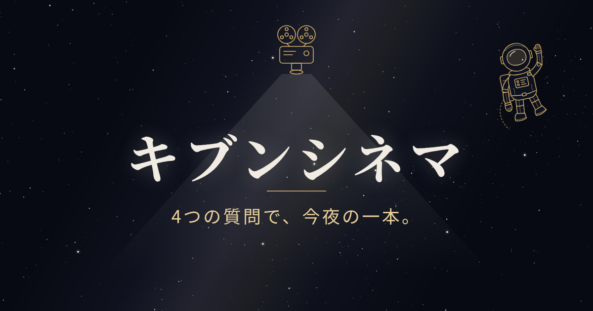
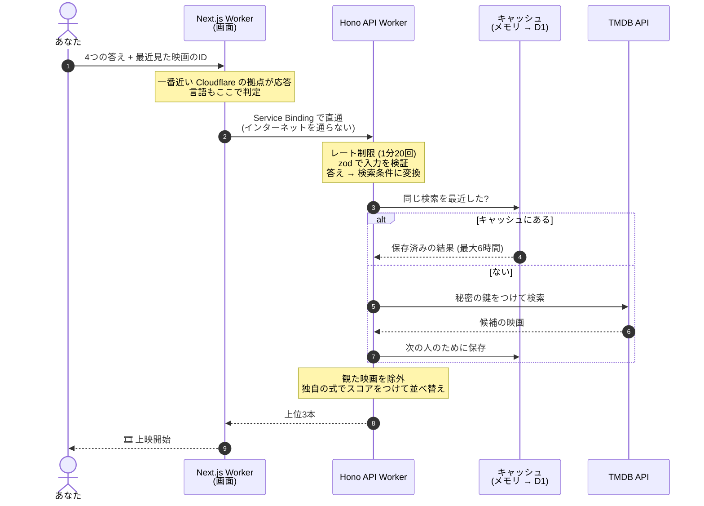
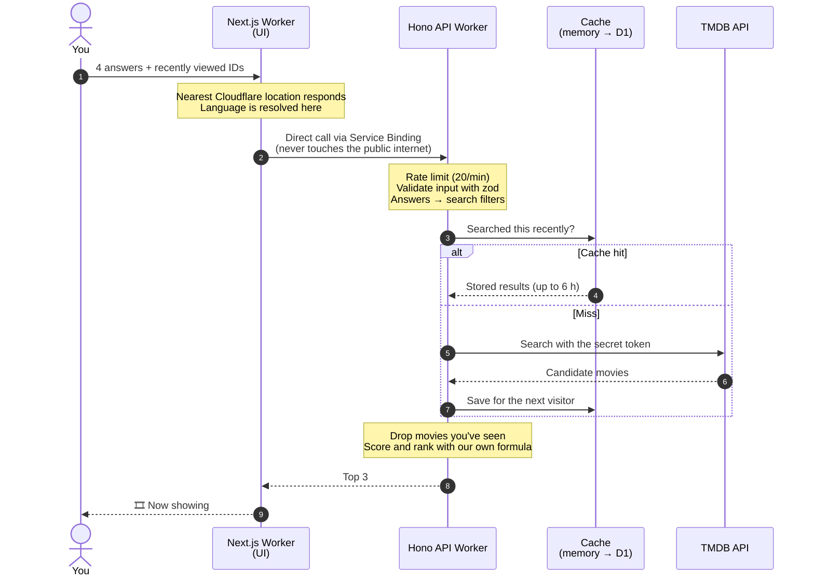

<div align="center">

<a href="#日本語">日本語</a> · <a href="#english">English</a>

<br><br>

<a href="https://kibuncinema-web.sennoriqueue.workers.dev">
  
</a>

<br><br>

[](https://github.com/sennoriqueue/kibuncinema/actions/workflows/deploy.yml)


**[▶ サイトを開く](https://kibuncinema-web.sennoriqueue.workers.dev)** · [English](https://kibuncinema-web.sennoriqueue.workers.dev/en) · [한국어](https://kibuncinema-web.sennoriqueue.workers.dev/ko)

</div>

<a id="日本語"></a>

## キブンシネマとは

今の気分を4つ答えるだけで、今夜観る映画が見つかるウェブサービスです。

| 🎟️ 1. 質問に答える | 🎞️ 2. 3本が上映される | 🍿 3. すぐ観る |
|:---:|:---:|:---:|
| 気分・誰と・長さ・時代 | 気分に合う順に並ぶ | 配信サービスへ直行 |

## 特徴

- 🌙 **夜の映画館をイメージした画面**：星空、映写機の光、ふわふわ浮かぶ宇宙飛行士
- 🌏 **3言語対応**：日本語・English・한국어。あらすじも配信サービスも、言語ごとの国のデータで表示
- ♡ **ログイン不要**：お気に入りと「最近見た映画」はブラウザに保存。個人情報を一切預からない
- 🔁 **同じ映画を出さない**：最近見た映画を候補から外して、毎回ちがう出会いを
- 🔒 **守りも本気**：API は外から直接たどり着けない設計。レート制限とキャッシュで、急なアクセス増にも耐える

## 数字で見るキブンシネマ

| **0** | **2層** | **3** | **1** |
|:---:|:---:|:---:|:---:|
| 公開された API の入口<br>（Service Binding で直結） | キャッシュ<br>（メモリ → D1） | 言語 × 国別の<br>配信サービス | つの型定義を<br>画面と API で共有 |

## 1回の「映画を探す」で起きていること

ボタンを押してから映画が出るまでの、ほんの一瞬のあいだに、これだけのことが起きています。



| # | どこで | 何をしているか |
|:-:|---|---|
| ① | ブラウザ | 4つの答えに、最近見た映画の ID を添えて送る |
| ② | **Next.js Worker** | 世界中にある Cloudflare の拠点のうち、利用者に一番近い場所で動く。URL と Cookie から言語を決める |
| ③ | **Service Binding** | 画面の Worker から API の Worker へ、インターネットを通らずに直接つなぐ。API には公開 URL がないので、外から直接たたけない |
| ④ | **Hono API Worker** | IP ごとのレート制限 → zod で入力の形をチェック → 答えを TMDB の検索条件（ジャンル・上映時間・公開年・年齢区分）に変換 |
| ⑤ | **2層キャッシュ** | まずメモリ、次に D1 を見る。同じ検索は6時間、映画の詳細は24時間使い回して、TMDB への問い合わせを減らす |
| ⑥ | **TMDB API** | キャッシュにないときだけ問い合わせる。トークンはサーバーのシークレットにだけ置き、ブラウザには一切出さない |
| ⑦ | **スコアリング** | 候補を採点して上位3本を返す。条件が厳しすぎてヒットが少ないときは、自動で条件をゆるめて探し直す |

## 推薦アルゴリズム

```text
score = 合うジャンルの数 × 2 − 避けたいジャンルの数 × 3 + 評価 × 0.3 + ゆらぎ(0〜2)
```

1. **気分で絞る**：「笑いたい」ならコメディ、「泣きたい」ならドラマや恋愛。さらに「笑いたいのにホラー」のような、気分を壊すジャンルは最初から外す
2. **誰と観るかで並べ替える**：恋人となら恋愛やコメディを上に、家族とならアニメやファミリー向けを上にして、年齢区分も絞る
3. **評価を少しだけ足す**：名作が上に来やすく、でも評価だけで決まらない重み
4. **ゆらぎを足す**：同じ答えでも毎回少しちがう3本に。偶然の出会いも映画の楽しみ

検索条件への変換表は [`apps/api/src/lib/tmdb-params.ts`](apps/api/src/lib/tmdb-params.ts) にあります。

## 技術スタック

| 層 | 技術 | 選んだ理由 |
|---|---|---|
| 画面 | **Next.js 16**（App Router）+ **OpenNext** | サーバー側で描画するので、X に貼ったときもカード画像とタイトルが出る |
| API | **Hono** | エッジ（世界中の拠点）で動かすために作られた、とても軽いフレームワーク |
| 実行環境 | **Cloudflare Workers** | サーバーの管理がいらず、世界中の拠点で一瞬で起動する |
| データベース | **Cloudflare D1** + **Drizzle ORM** | SQLite をエッジで。テーブル定義から型が作られるので、書き間違いをビルド時に見つけられる |
| 型と検証 | **TypeScript** + **zod** | 質問の定義と入力チェックを1か所に書き、画面と API の両方で同じものを使う |
| 多言語 | 自作の辞書 + Middleware | 3言語の文言を型でそろえ、訳し忘れがあるとビルドが通らない |
| 映画データ | **TMDB API** / JustWatch | 世界中の映画情報と、国ごとの配信サービス |
| CI/CD | **GitHub Actions** + **Dependabot** | PR ごとに型チェックとビルド、main に入ると DB の更新 → API → 画面の順に自動デプロイ |

### セキュリティとコストへの備え

- **API を隠す**：API の Worker は `workers_dev: false` で公開 URL を持たず、画面の Worker からしか呼べない
- **レート制限**：映画探しは1分20回、詳細は1分60回まで（IP ごと、Workers Rate Limiting）
- **秘密を出さない**：TMDB のトークンは Cloudflare のシークレットと GitHub Secrets にだけ置く
- **セキュリティヘッダー**：`next.config.ts` で付与し、`X-Powered-By` も消している
- **キャッシュで節約**：アクセスが増えても TMDB への問い合わせは増えにくく、無料枠に収まりやすい

<details>
<summary><b>🛠 開発者向け：フォルダ構成と API</b></summary>

### フォルダ構成

```
apps/
  web/        Next.js。/api/* はすべて API の Worker に中継する
  api/        Hono。推薦・映画の詳細（認証・お気に入り・履歴・アイコンは停止中）
    migrations/   D1 のマイグレーション（SQL）
packages/
  shared/     質問の定義、入力チェック、言語の設定、API の型（web と api の両方で使う）
  db/         Drizzle のスキーマ
```

ブラウザは Next.js の Worker だけにアクセスします。`/api/*` へのリクエストは
`apps/web/src/app/api/[...path]/route.ts` が API の Worker に中継します
（本番は Service Binding、ローカルは `API_ORIGIN` への fetch）。
画面と API が同じドメインになるので、ログインの Cookie をそのまま使えます。

### API

| メソッド | パス | 内容 | ログイン |
|---|---|---|---|
| POST | `/api/recommend` | 質問の答えから映画を探す | 任意 |
| GET | `/api/movies/:id?locale=` | 映画の詳細と、その言語の国で観られる配信サービス（JustWatch 提供） | - |
| GET/POST | `/api/auth/*` | Better Auth（ログイン、ログアウト、コールバック） | - |
| GET | `/api/favorites` | お気に入りの一覧 | 必須 |
| POST | `/api/favorites` | お気に入りに追加 | 必須 |
| DELETE | `/api/favorites/:tmdbId` | お気に入りから外す | 必須 |
| GET | `/api/history` | 最近の提案（20件） | 必須 |
| GET | `/api/me` | 自分の情報 | 任意 |
| PUT | `/api/me/avatar` | アイコン画像を R2 に保存（本文に画像、2MB まで） | 必須 |
| GET | `/api/images/avatars/:id` | アイコン画像を返す | - |

ログインが必要なものは、今はログイン機能を止めているため使われていません。
選択肢を増やすときは `packages/shared/src/questions.ts` と `apps/api/src/lib/tmdb-params.ts` を一緒に変更してください。

</details>

<details>
<summary><b>💻 開発者向け：ローカルで動かす</b></summary>

必要なもの：Node.js 22.12 以上（wrangler の条件）、pnpm、Cloudflare のアカウント、TMDB のアカウント。

```sh
pnpm install
```

### 1. Cloudflare のリソースを作る

```sh
cd apps/api
pnpm wrangler login
pnpm wrangler d1 create kibuncinema          # 表示された database_id を wrangler.jsonc に書く
```

### 2. シークレットを用意する

```sh
cp apps/api/.dev.vars.example apps/api/.dev.vars
cp apps/web/.env.example apps/web/.env.local
```

`apps/api/.dev.vars` に次の値を入れます。今はログイン機能を止めているので、必要なのは `TMDB_TOKEN` だけです。

- `TMDB_TOKEN`：TMDB の設定画面 → API にある「API 読み取りアクセストークン」

ログイン機能を戻すときは、次の3つも入れます（3つそろったときだけログインが動きます）。

- `BETTER_AUTH_SECRET`：`openssl rand -base64 32` などで作ったランダムな文字列
- `GOOGLE_CLIENT_ID` / `GOOGLE_CLIENT_SECRET`：Google Cloud Console →「API とサービス」→「認証情報」で
  OAuth クライアント ID（ウェブアプリケーション）を作成。
  承認済みのリダイレクト URI に `http://localhost:3000/api/auth/callback/google` を追加する

### 3. データベースを作って起動する

```sh
pnpm db:migrate:local
pnpm dev            # API: http://localhost:8787 / 画面: http://localhost:3000
```

http://localhost:3000 を開きます。英語は `/en`、韓国語は `/ko` です。

</details>

<details>
<summary><b>🚀 開発者向け：本番へのデプロイ</b></summary>

`main` にマージすると、GitHub Actions（`.github/workflows/deploy.yml`）が自動で本番にデプロイします。
画面側を Workers 用に変換する OpenNext は Windows での動作が保証されていないため、ビルドは GitHub の Linux 環境で行います。
PR を出すと `.github/workflows/check.yml` が型チェックとビルドを確認します。

### 最初に一度だけやること

1. **D1 の database_id を設定する**：`apps/api` で `pnpm wrangler d1 list` を実行し、
   `kibuncinema` の ID を `apps/api/wrangler.jsonc` の `database_id` に書いて `main` に入れる
2. **TMDB のトークンを本番に登録する**（`apps/api` で実行）
   ```sh
   pnpm wrangler secret put TMDB_TOKEN
   ```
   まだ一度もデプロイしていないときは「Worker を作るか」と聞かれるので、そのまま作る
3. **Cloudflare の API トークンを作る**：ダッシュボード → 右上のアイコン →「プロフィール」→「API トークン」→「トークンを作成」。
   「Cloudflare Workers を編集する」テンプレートを使い、権限に「アカウント → D1 → 編集」を追加する
4. **GitHub にシークレットを登録する**：リポジトリの Settings → Secrets and variables → Actions → New repository secret
   - `CLOUDFLARE_API_TOKEN`：3 で作ったトークン
   - `CLOUDFLARE_ACCOUNT_ID`：ダッシュボードの「Workers & Pages」の画面右側などに表示されるアカウントID
5. GitHub の Actions タブ →「Deploy」→「Run workflow」で手動実行するか、`main` にマージする

デプロイが終わると、画面は `https://kibuncinema-web.<アカウントのサブドメイン>.workers.dev` で公開されます。

</details>

<details>
<summary><b>🌏 開発者向け：多言語対応</b></summary>

- URL：日本語は前置きなし（`/movie/1`）、英語は `/en/…`、韓国語は `/ko/…`。`apps/web/src/middleware.ts` が振り分ける
- トップに初めて来た人は、選んだ言語（Cookie）か、ブラウザの言語設定で振り分ける。日本語・韓国語以外の人には英語
- 画面の文言は `apps/web/src/i18n/ja.ts`・`en.ts`・`ko.ts`。文言を足すときは3つすべてに足す（足りないと型チェックで分かる）
- 映画のタイトル・あらすじは TMDB からその言語で取る。配信サービスは言語で国を決める（日本語→日本、英語→アメリカ、韓国語→韓国）。
  設定は `packages/shared/src/locale.ts`
- 共有カードの画像は `public/og.png`・`og-en.png`・`og-ko.png`

</details>

<details>
<summary><b>🔑 開発者向け：ログイン機能とスキーマ変更</b></summary>

### ログイン機能

今は Google ログインを止めていて、ログインなしで使えます。

- お気に入りと「最近見た映画」は、そのブラウザの localStorage に保存します（`apps/web/src/lib/local-store.ts`）。
  最近見た映画は30日で自動で消えます。別の端末やブラウザとは共有されません
- ログイン関係のコード（Better Auth・お気に入りと履歴の API・R2 へのアイコン保存）は残してあります。
  API はシークレットがそろっていないとき、ログインしていない扱いで動きます
- 戻すときは、`apps/web/src/app/[locale]/layout.tsx` の `<MyListLink />` を `<AuthButton />` に戻し、シークレットを登録します。
  アイコン画像を使うなら R2 のバケットも作り、`apps/api/wrangler.jsonc` の r2 の設定を戻します

### スキーマを変えるとき

1. `packages/db/src/schema.ts` を編集
2. `pnpm --filter @kibuncinema/db generate` で `apps/api/migrations` に SQL を生成
3. `pnpm db:migrate:local`（本番は `main` に入れると自動で実行）

### メモ

- Cloudflare のドキュメントでは、新しい Next.js アプリには OpenNext ではなく vinext が推奨されるようになっています。
  このリポジトリは OpenNext で組んでいます。移行する場合は `apps/web` の `next.config.ts`・`open-next.config.ts`・`wrangler.jsonc` が対象です
- 配信サービスのデータは JustWatch 提供のため、詳細画面にクレジットを表示しています（TMDB の条件）。
  TMDB は作品ページへの直リンクを返さないので、各サービスの検索結果に飛ばしています（`apps/web/src/lib/watch-links.ts`）

</details>

---

<a id="english"></a>

## What is Kibun Cinema?

Answer four quick questions about your mood, and it picks tonight's movie for you.

| 🎟️ 1. Answer | 🎞️ 2. Three films screen | 🍿 3. Watch now |
|:---:|:---:|:---:|
| Mood, company, length, era | Ranked to fit your mood | Jump straight to streaming |

## Features

- 🌙 **A night-time movie theater**: a starry sky, a projector beam and a drifting astronaut
- 🌏 **Three languages**: 日本語, English and 한국어. Synopses and streaming services come from each language's country
- ♡ **No sign-up**: favorites and recently viewed movies stay in your browser. No personal data is stored
- 🔁 **Never the same film twice**: recently viewed movies are left out, so every visit brings something new
- 🔒 **Built to hold up**: the API can't be reached from the internet directly, and rate limits plus caching absorb traffic spikes

## By the numbers

| **0** | **2 layers** | **3** | **1** |
|:---:|:---:|:---:|:---:|
| public API endpoints<br>(Service Binding) | of cache<br>(memory → D1) | languages, each with<br>its own country's services | type definition shared<br>by the UI and the API |

## What happens when you press "Find a movie"

In the blink of an eye between the click and the screening, all of this happens:



| # | Where | What it does |
|:-:|---|---|
| ① | Browser | Sends the four answers along with recently viewed movie IDs |
| ② | **Next.js Worker** | Runs at the Cloudflare location closest to you and picks the language from the URL and a cookie |
| ③ | **Service Binding** | Connects the UI Worker to the API Worker without going over the internet. The API has no public URL at all |
| ④ | **Hono API Worker** | Per-IP rate limiting → zod validation → turns answers into TMDB filters (genres, runtime, release years, age ratings) |
| ⑤ | **Two-layer cache** | Checks memory first, then D1. Searches are reused for 6 hours and movie details for 24 hours, cutting calls to TMDB |
| ⑥ | **TMDB API** | Only called on a cache miss. The token lives in server-side secrets and never reaches the browser |
| ⑦ | **Scoring** | Ranks the candidates and returns the top three. If the filters are too strict, it automatically relaxes them and searches again |

## The recommendation formula

```text
score = matching genres × 2 − genres to avoid × 3 + rating × 0.3 + randomness (0–2)
```

1. **Filter by mood**: comedy when you want to laugh, drama and romance when you want to cry, and genres that would ruin the mood (horror when you want to laugh) are excluded up front
2. **Re-rank by company**: romance and comedy rise for a date, animation and family films rise with family, and age ratings are narrowed
3. **Add a little rating**: classics tend to rise, but rating alone doesn't decide
4. **Add some randomness**: the same answers give a slightly different three each time, because chance encounters are part of the fun

The mapping lives in [`apps/api/src/lib/tmdb-params.ts`](apps/api/src/lib/tmdb-params.ts).

## Tech stack

| Layer | Technology | Why |
|---|---|---|
| UI | **Next.js 16** (App Router) + **OpenNext** | Server rendering, so links shared on X show a title and card image |
| API | **Hono** | An ultralight framework built for the edge |
| Runtime | **Cloudflare Workers** | No servers to manage, instant start-up in locations around the world |
| Database | **Cloudflare D1** + **Drizzle ORM** | SQLite at the edge, with types generated from the schema so mistakes surface at build time |
| Types and validation | **TypeScript** + **zod** | Questions and input checks are defined once and shared by the UI and the API |
| i18n | Custom dictionaries + middleware | All three languages share one type, so a missing translation fails the build |
| Movie data | **TMDB API** / JustWatch | Worldwide movie data and per-country streaming availability |
| CI/CD | **GitHub Actions** + **Dependabot** | Every PR is type-checked and built; merging to main deploys the DB migrations → API → UI automatically |

### Security and cost

- **Hidden API**: the API Worker sets `workers_dev: false`, so it has no public URL and only the UI Worker can call it
- **Rate limits**: 20 searches and 60 detail views per minute per IP (Workers Rate Limiting)
- **No leaked secrets**: the TMDB token lives only in Cloudflare secrets and GitHub Secrets
- **Security headers**: set in `next.config.ts`, with `X-Powered-By` removed
- **Caching saves money**: more visitors barely increase calls to TMDB, so it fits comfortably in free tiers

<details>
<summary><b>💻 For developers: run it locally</b></summary>

Requirements: Node.js 22.12 or later, pnpm, a Cloudflare account and a TMDB account.

```sh
pnpm install
cd apps/api && pnpm wrangler login && pnpm wrangler d1 create kibuncinema   # put the database_id in wrangler.jsonc
cd ../..
cp apps/api/.dev.vars.example apps/api/.dev.vars   # set TMDB_TOKEN (TMDB settings → API → read access token)
cp apps/web/.env.example apps/web/.env.local
pnpm db:migrate:local
pnpm dev            # API: http://localhost:8787 / UI: http://localhost:3000
```

Merging to `main` deploys to production through `.github/workflows/deploy.yml`.
The workflow needs the `CLOUDFLARE_API_TOKEN` and `CLOUDFLARE_ACCOUNT_ID` repository secrets, and the API needs `TMDB_TOKEN` set with `wrangler secret put`.
The detailed guide is in the Japanese section above.

</details>

---

<div align="center">

Made by 支配人 **千利休 (Sen no Rikyu)** · [@sennoriqueue](https://x.com/sennoriqueue)

<br>

<a href="https://www.themoviedb.org/"></a>

This product uses the TMDB API but is not endorsed or certified by TMDB.<br>
Streaming availability data provided by JustWatch.

</div>
